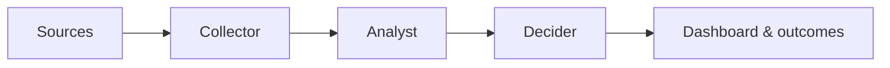

# Feedback Prioritizer

[](https://github.com/MadanMohan0537/feedback-prioritizer/actions/workflows/ci.yml)
[](LICENSE)

**Collect customer feedback from several channels into one local store, redact common contact details in the normalized text, group messages into topics, and rank those topics with a score anyone can read and adjust.**

A local-first Python app with a Streamlit dashboard. The collector command is `python pulse.py`.

## Problem and who it's for

Support tickets, app-store reviews, surveys, and sales conversations each show only part of the customer experience. Copying them into a spreadsheet does not fix that: records get duplicated, personal details leak, the source context disappears, and the loudest anecdote still wins. This is for product managers, product ops, and customer-experience leads who need a defensible "work on this first" list.

## Approach



| Layer | What it does |
|---|---|
| **Collector** | Fetch records, validate them, redact normalized text, upsert by `(source, external_id)`, store a checkpoint, and write SQLite tables for normalized rows, raw payloads, and dead letters. |
| **Analyst** | Split a review into opinion units, score sentiment, cluster topics, and flag feature-request phrases. Optional packages add a RoBERTa sentiment model and BERTopic. With `requirements.txt`, sentiment uses VADER and topics use TF-IDF/KMeans. |
| **Decider** | Rank complaint topics with a five-factor score. The dashboard sliders change the weights, and the weights are rescaled so they sum to 1. |
| **Governance and outcomes** | Save a topic name, owner, and status. Marking a topic released stores the current average polarity so a later view can show the change. |

Default weights from `src/config.py`:

```text
priority = 100 × (0.28 × frequency + 0.24 × negativity + 0.20 × business impact
                  + 0.16 × emerging trend + 0.12 × customer value)
```

Each factor is scaled into 0–1 before weighting. Frequency, business impact, emerging trend, and customer value are min-max scaled across the topics in view. Negativity is `(1 - average polarity) / 2`.

A topic is listed as a feature request when at least 40% of its messages match the phrase list in `src/config.py`. The dashboard orders that list by mention count. Complaint topics stay ordered by the weighted score.

## What exists today

Checked on this tree with Python 3.12.3 and `requirements.txt`:

- Collector commands: `init`, `fetch`, `stats`, `export`, and `delete-user`. `fetch --source` accepts `synthetic`, `file`, `json`, `typeform`, `zendesk`, `intercom`, `apple`, and `google-play`.
- Those connectors build one `FeedbackEntry`. SQLite enforces `UNIQUE(source, external_id)` and stores a SHA-256 of the normalized text on each row. The same text under another external id is stored again.
- A second dashboard importer, `src/connectors.py`, can pull JSON for GitHub, Slack, Zendesk, Intercom, and app reviews into the in-memory stream. That path does not write the collector database.
- Normalized text is scanned for emails, phone numbers, and IPv4 addresses. Non-empty user ids are stored as a salted SHA-256 (`PULSE_HASH_SALT`, or `pulse-local` when unset). `delete-user` removes matching normalized rows.
- The Streamlit app replays the bundled 650-row synthetic CSV (`data/sample_reviews.csv`), can upload another CSV, and can load rows from the collector SQLite file. Sidebar sliders edit the five weights.
- 23 unit tests passed (`python -m unittest discover -s tests -p "test_*.py" -v`). `python tests/smoke_test.py` completed: it loaded 650 rows, scored the first 200 with VADER, and fit TF-IDF/KMeans.
- `python scripts/evaluate.py` on the bundled CSV, with the transformer forced off and BERTopic unavailable, prints:

```json
{
  "sentiment": {"rating_proxy_accuracy": 0.431, "rated_sample_count": 775},
  "topic_model": {
    "adjusted_rand_index": 0.0376,
    "normalized_mutual_info": 0.3237,
    "sample_count": 775
  }
}
```

The 775 rows are opinion units expanded from the 650-row file. Each unit keeps its parent star rating and generated topic label. The rating proxy treats 1–2 stars as negative, 3 as neutral, and 4–5 as positive. Predicted labels use polarity below -0.05 as negative and above 0.05 as positive. The same run reported eight topics, with scores bounded, sorted descending, and accompanied by factor contributions. The unit tests exercise the metric helpers on small fixtures. This run used the fallback models only. GitHub Actions (`.github/workflows/ci.yml`) on Python 3.12 compiles `app.py`, `src`, and `tests`, then runs the unit tests, the smoke test, and this evaluation. The completed run on `main` on 4 October 2026 succeeded.

A local `fetch --source synthetic --count 100` stored 100 rows. Running it again reported 100 duplicates and left the stored count at 100. `export` wrote 100 JSONL rows. `streamlit run app.py` answered HTTP 200 on port 8501.

## How success would be measured

| Measure | Status |
|---|---|
| Additional rows stored when the same synthetic source is fetched again | Tested in `tests/test_collector.py`: the stored count does not grow. Not measured on a live vendor feed. |
| Sentiment and topic quality on a labeled, anonymized sample from a real organization | Not yet measured. The synthetic-data figures are above. |
| Agreement between product managers and the top-ranked issues | Not yet measured |
| Sentiment change after a topic is marked released | The dashboard can store a baseline polarity and show a later delta. Not yet measured on real releases. |

## Limitations

- The collector HTTP connectors are implemented and have no unit tests. Tests for `src/connectors.py` check dashboard JSON normalization, including one GitHub issue and one empty Zendesk ticket. They do not call Typeform, Zendesk, Intercom, Apple, or Google Play.
- Vendor connectors send a token you supply. They do not run an OAuth login flow. Typeform, Zendesk, Intercom, and the generic JSON connector pass the saved cursor on the next request. The Apple App Store and Google Play connectors store a cursor and do not put it in the next request URL.
- Redaction is a regex over normalized text. Raw payloads in `raw_events`, and connector metadata, are stored as received. There is no command that replays raw events or dead letters. `delete-user` does not delete raw payloads.
- Each row stores a content hash. A new external id with the same text becomes another row. Grouping of near-duplicate wording is not implemented.
- A tiny builtin word list is used only when VADER cannot be imported. Opinion splitting is a sentence and contrast-clause heuristic.
- Default weights and impact keywords live in `src/config.py`. They have not been fit to an organization's outcomes.
- The database is one local SQLite file. Cloudflare Workers is the intended host, and this repo has no Worker config yet. See Deployment.

## Quick start

Requires Python 3.10 or newer. `src/collector/storage.py` uses `str | Path` annotations, which are evaluated at import. CI installs `requirements.txt` on Python 3.12. These commands were run with Python 3.12.3.

```bash
git clone https://github.com/MadanMohan0537/feedback-prioritizer.git
cd feedback-prioritizer
python -m venv .venv
source .venv/bin/activate          # Windows: .venv\Scripts\activate
pip install -r requirements.txt

python pulse.py init
python pulse.py fetch --source synthetic --count 100
python pulse.py stats
python pulse.py export --output exports/feedback.jsonl
streamlit run app.py
```

Checks:

```bash
python -m unittest discover -s tests -p "test_*.py" -v
python tests/smoke_test.py
python scripts/evaluate.py
```

`requirements-full.txt` adds the optional RoBERTa and BERTopic packages. Those packages were not installed for the numbers above. Source names are listed by `python pulse.py fetch --help`. Credential variable names are in `.env.example`.

## Deployment

Cloudflare Workers is the planned target. Deploy with `npx wrangler deploy`. This repo has no `wrangler.toml`, no Worker entry point, and no Worker name, so that command is not configured yet and nothing is deployed.

What is still needed:

- `wrangler.toml`
- a Worker entry point
- for this Python app, either Cloudflare Python Workers or a JavaScript/TypeScript port

## Related repositories

- [ai-product-discovery-engine](https://github.com/MadanMohan0537/ai-product-discovery-engine): JavaScript project that turns feedback into evidence-linked opportunities.
- [product-evidence-to-decision-suite](https://github.com/MadanMohan0537/product-evidence-to-decision-suite): keeps feedback evidence linked from prioritization through experiments and governance.

## License

MIT. See [LICENSE](LICENSE).
